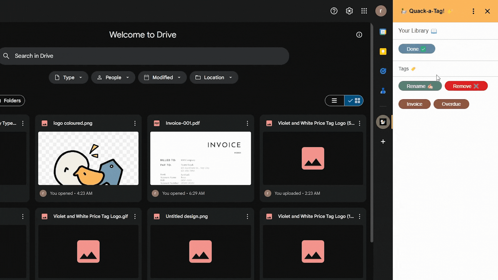
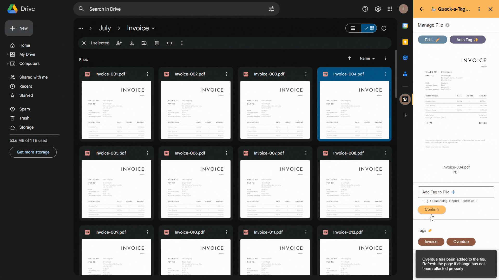
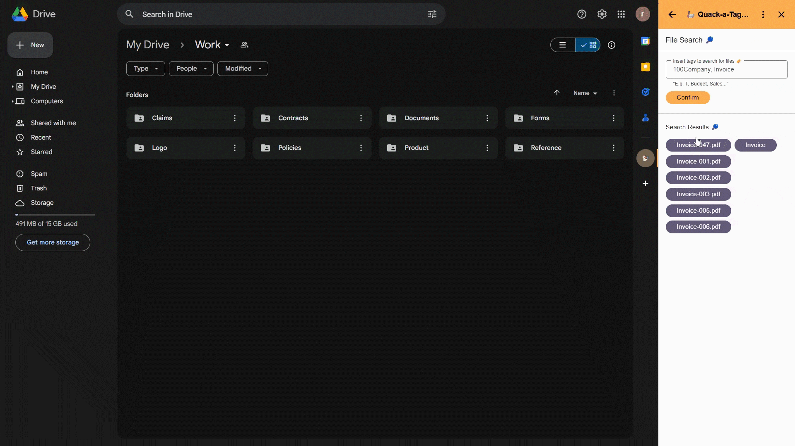
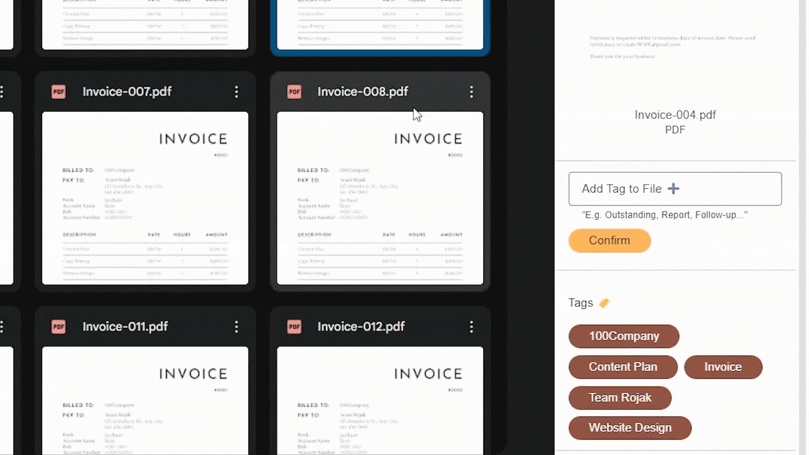

# Quack-a-Tag


Quack-a-Tag is a Google Drive add-on prototype built for [Google Hackathon](https://hack.gdsc-apu.com/) in 2024. It helps users organize Drive files with custom tags, search by tag combinations, and generate suggested tags from file thumbnails using Gemini.

This repository is prepared as a public portfolio version of the original private team hackathon project. Sensitive deployment values are intentionally excluded.

## Hackathon Context

This project was built as a fast-moving team prototype for [Google Hackathon](https://hack.gdsc-apu.com/) in 2024, with most original development activity happening in July and August 2024. The goal was to explore how a Drive add-on could make file organization less manual by combining custom labels, tag-based retrieval, and AI-generated tag suggestions.

The original private project depended on hackathon-only Firebase, Gemini, ImgBB, and Apps Script configuration. This public version keeps the application source and documents the setup boundary, but does not publish private deployment credentials or live service IDs.

## Features

- Manage a personal tag library for Google Drive files.
- Add, remove, and rename tags.
- Apply tags to one selected file or multiple selected files.
- Search Drive files by assigned tags.
- Generate tag suggestions with Gemini Vision from Drive file thumbnails.
- Clean up tag records for files that have been deleted from Drive using a time-driven Apps Script trigger.

## Tech Stack

- Google Apps Script
- Google Workspace Drive Add-ons / CardService UI
- Google Drive API scopes
- Firebase Realtime Database
- Gemini API
- ImgBB API for thumbnail upload support

## UI Preview

These screenshots were taken from the original hackathon presentation deck and show the Google Drive add-on sidebar in use.

| Library | Manage File |
| --- | --- |
|  |  |

| File Search | Multi-select Tagging |
| --- | --- |
|  |  |

## How It Works

When installed as a Google Drive add-on, Quack-a-Tag appears in the Drive add-on sidebar. Users can:

1. Open the add-on from Google Drive.
2. Create tags in the personal library.
3. Select one or more Drive files.
4. Attach existing tags or ask Gemini to suggest tags from the file thumbnail.
5. Search for files later by selecting one or more tags.

Tag data is stored per user in Firebase. The implementation hashes user-specific paths before writing tag records and uses a time-driven Apps Script trigger to remove records for Drive files that no longer exist.

## Repository Structure

```text
.
|-- code.js            # Main Google Apps Script add-on logic and UI flows
|-- timeTrigger.js     # Time-driven cleanup trigger for deleted Drive files
|-- manifest.js        # Apps Script manifest template
|-- logo coloured.png  # Add-on logo asset
|-- docs/screenshots   # Screenshots extracted from the hackathon deck
`-- .env.example       # Example private configuration values
```

## Setup Notes

This is a hackathon prototype, not a packaged production add-on. To run it yourself:

1. Create a Google Apps Script project.
2. Copy `code.js` and `timeTrigger.js` into the project.
3. Convert `manifest.js` into the Apps Script manifest file (`appsscript.json`) or paste its JSON into the manifest editor.
4. Create a private Apps Script library or equivalent configuration layer that provides:
   - `getFIREBASE_URL()`
   - `getFIREBASE_SECRET()`
   - `getGEMINI_ENDPOINT()`
   - `getIMGBBAPIKEY()`
5. Replace the placeholder library ID in `manifest.js` with your private library ID.
6. Deploy and test the add-on from Google Apps Script.

Do not commit real API keys, Firebase secrets, Apps Script deployment IDs, or service account files.
